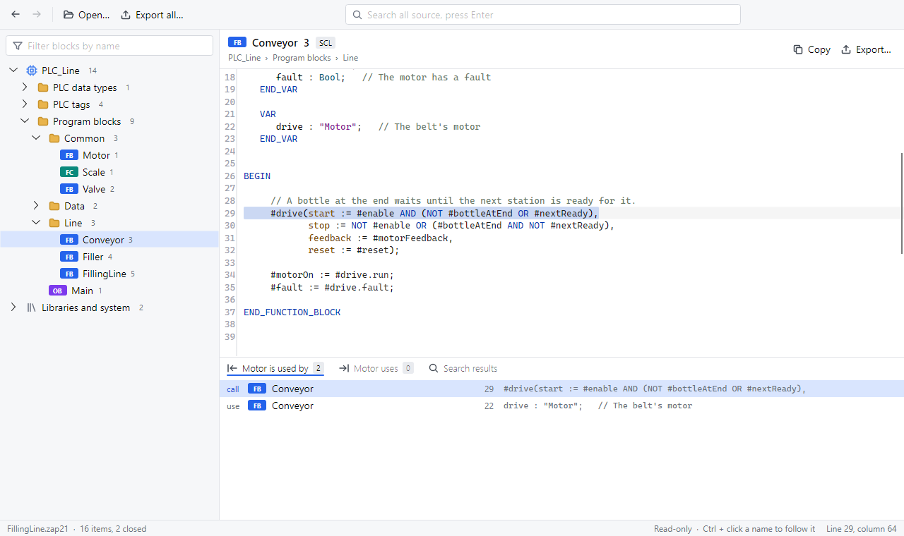
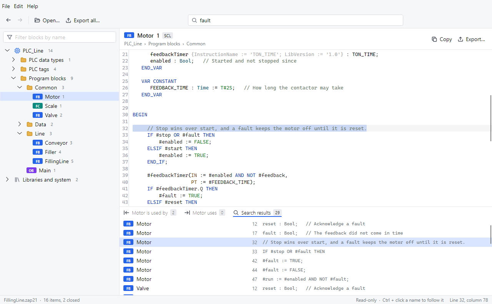

<p align="center">
  
</p>

<h1 align="center">TiaTools</h1>

<p align="center">
  Read Siemens TIA Portal projects without TIA Portal.<br>
  A viewer, a command line tool and a .NET library, for Windows and macOS. Read-only.
</p>

<picture>
  <source media="(prefers-color-scheme: dark)" srcset=".github/images/viewer-dark.png">
  
</picture>

A PLC program lives in a TIA Portal project, and reading one usually takes TIA Portal: Windows, a licence and a large install. TiaTools reads the project's own file instead, so you can read the program on a Mac, review it on a laptop that has no TIA, or let a coding agent search it.

- **The program as written.** Blocks, data types and tag tables in their folders, SCL source with its comments and layout.
- **Follow the code.** Ctrl or Cmd + click a name to go to it, and see who calls a block and what it uses.
- **Search** across all source of every PLC in the project.
- **Export** everything, a folder or one block as plain text files, for grep, diff or review.
- **Close to TIA.** On a real project, 786 of 790 SCL blocks, data blocks and data types come out byte-identical to the source TIA Portal itself generates.
- **Nothing changes.** It never writes to a project, and know-how protected blocks stay closed.

It reads project archives (`.zap*`), projects (`.ap*`) and global libraries (`.al*`). It has been tried with files from TIA Portal V15.1, V20 and V21.

> **Status:** early. It was compared block by block with TIA Portal on one real project, and has read a few others; see [how far to trust the output](#how-far-to-trust-the-output). For Windows and macOS, the viewer and `tiadump` are on the [releases page](https://github.com/swimmesberger/TiaTools/releases/latest); on Linux, build them from source, which takes a minute.

## The viewer

| Who uses a block | Search all source |
|---|---|
| <picture><source media="(prefers-color-scheme: dark)" srcset=".github/images/references-dark.png"></picture> | <picture><source media="(prefers-color-scheme: dark)" srcset=".github/images/search-dark.png"></picture> |

On Windows, download `TIA-Viewer-<version>-win-x64.zip` from the [latest release](https://github.com/swimmesberger/TiaTools/releases/latest), unpack it and run `TiaViewer.exe`. It needs nothing else installed. It is not signed yet, so Windows SmartScreen may warn the first time; *More info › Run anyway* starts it.

On a Mac, download `TIA-Viewer-<version>-macos-universal.zip` from the same release, for Apple silicon and Intel from macOS 13, unpack it and move `TIA Viewer.app` to *Applications*. It needs nothing else installed. It is not signed with a Developer ID or notarized yet, so macOS blocks it the first time: open it once, then choose *Open Anyway* in System Settings › Privacy & Security. Or, in Terminal: `xattr -dr com.apple.quarantine "/Applications/TIA Viewer.app"`.

To run it from source instead, install the [.NET 10 SDK](https://dotnet.microsoft.com/download), then from a clone of this repository:

```bash
dotnet run --project src/TiaViewer -c Release -- Project.zap21
```

- **Open:** the button, *File › Open…* or Ctrl or Cmd + O, drag and drop, or an argument. *File › Open Recent* and the start screen list the last ten archives, projects and libraries opened.
- **Follow a name:** Ctrl or Cmd + click it in the source. Back and forward are on Alt+Left and Alt+Right.
- **Who uses this:** the tabs below the source. Walking through a list keeps the list.
- **Search:** the box at the top for all source (Ctrl or Cmd + Shift + F), Ctrl or Cmd + F within a block, the box on the left for block names. Both are in the *Edit* menu too.
- **Export:** *Export all…* in the toolbar, *Export…* above a block, or right-click a PLC or folder in the tree. It writes the same files as `tiadump dump`, with an `index.tsv` of what it wrote, into a new folder inside the one you choose, so nothing there is overwritten.
- **OPC UA:** the first entry under each PLC of the project shows its OPC UA configuration the way TIA Portal lays it out: the server's General, Options and Security settings, its server interfaces and roles, its data blocks and tags with TIA's access columns, and the nodes an OPC UA client can browse, with their node ids, to copy or export as a node set file. Double-click a data block, tag or node to open it. What is not confirmed against TIA says so. *Copy* copies the text `tiadump opcua --plc <PLC>` writes. It is read when first shown, is not searched, and is left out of an export.
- **Copy:** *Copy* above a block puts its source on the clipboard; so does right-clicking it in the tree, or *Edit › Copy* while the tree has the focus.
- **Menus:** on a Mac in the menu bar, with *About TIA Viewer* in the app menu; on Windows in the window, with *About* under *Help*.

The recent files are kept in `~/Library/Application Support/TIA Viewer` on a Mac and `%LOCALAPPDATA%\TIA Viewer` on Windows; on a Mac they also go to the system's recent documents. *Clear Menu* forgets them.

References come from source, so a closed block's calls are not among them. The viewer says how many blocks that affects, and a short list may be incomplete. It sees direct calls, calls through instance data blocks and multi-instances, and other uses by name; it does not yet tell a read from a write.

Colours and links come from the tokens stored in the project, not from a grammar. Declarations and FBD text, which have no stored tokens, go through a small scanner.

### As an app

Native AOT makes it a single program that starts in under a second. Publish it on the system it is for, since Native AOT does not compile for another one. On Windows this needs Visual Studio's C++ tools, with `vswhere.exe` on the `PATH`:

```bash
dotnet publish src/TiaViewer -c Release -r win-x64
```

On a Mac, this builds `artifacts/TIA Viewer.app`, signed ad hoc, and registers it for `.zap*`, `.ap*` and `.al*` files of V11 to V30, so that a double-click opens them:

```bash
src/TiaViewer/macos/bundle.sh
```

It needs Xcode's command line tools. Homebrew's .NET is built from source, and its Native AOT link asks for OpenSSL and Brotli, which macOS has none of to link against. The script then takes them from Homebrew (`brew install openssl@3 brotli`), and says so. Such an app only runs where Homebrew has them installed, so build one to hand to others with Microsoft's .NET SDK, which links neither. The Mac zips on the releases page are built that way, for Apple silicon and Intel in one, by `tools/release_macos.sh` ([releasing](docs/releasing.md)).

**How far it is tested.** On Windows, through Native AOT, on a real project: opening takes under a second, and following a call, the lists, search, export and a 20,000 line data block all work. On macOS it builds and runs as an app: the menu bar and its Cmd shortcuts, About, the recent files, the open dialog, and a file opened through Launch Services as a double-click does, were checked; Cmd + click to follow a name is not confirmed yet. Windows has no file association yet, so use *Open with*. The downloads are not signed with a certificate yet, so Windows and macOS each ask once before the first start, as described above.

## The command line

On Windows, download `tiadump-<version>-win-x64.zip` from the [latest release](https://github.com/swimmesberger/TiaTools/releases/latest): one `tiadump.exe`. On a Mac, download `tiadump-<version>-macos-universal.zip`: one `tiadump`, which macOS blocks until you run `xattr -d com.apple.quarantine tiadump` once. Neither needs anything else installed. On Linux, build it:

```bash
dotnet build src/TiaDump -c Release
```

The tool is then at `src/TiaDump/bin/Release/net10.0/tiadump` (`tiadump.exe` on Windows). The examples below call it `tiadump`.

`<archive>` is one of:

- a `.zap*` project archive, for example `Project.zap20`
- an unpacked project or library folder, which is also how to read a global library (`.al*`): pass its folder
- the file a project or library opens by, for example `Project.ap21`
- a `PEData.plf` file

| Command | What it does | Options |
|---|---|---|
| `tiadump list <archive>` | One line per block: PLC, environment, kind, number, `KHP` if protected, `STUB` if held elsewhere, language, name and folder. The block count goes to stderr | `--grep <regex>` on the name, `--stubs` to include references to blocks held elsewhere |
| `tiadump show <archive> <name>` | Prints every block of exactly that name as source. Exits with 1 if there is none | `--plc <name>` for one PLC only |
| `tiadump inspect <archive> <name or id>` | Prints what is stored for a block or object: attributes, dictionary expando values (marked `~`) and relations, for finding where a fact lives. Encrypted values stay closed, and values named like a password, key, hash or certificate are not shown | `--plc <name>` for one PLC, `--full` to print long values whole |
| `tiadump dump <archive> <folder>` | Writes all blocks and tag tables as files, and creates the folder if needed. Takes about a second for a 60 MB archive. Exits with 1 if a block failed; the rest are still written | `--grep <regex>` on the name (no tag tables then), `--raw` to add each network as stored, `--verify` to check every frame's hash |
| `tiadump opcua <archive>` | Reports each PLC's OPC UA server as Markdown: whether it is on, its application name, security policies and other settings, its roles and server interfaces, and which data blocks, members and tags an OPC UA client could read or write. Never shows passwords, keys, hashes or certificates. Some readings are not yet confirmed against TIA, and the report says which | `--json` for every data block and tag as JSON, `--plc <name>` for one PLC only, `--nodes` for the nodes of the standard server interface as tab-separated text, `--nodeset` for one PLC's node set file, as TIA's *OPC UA › Server › Export* writes it |
| `tiadump compare <dump> <export>` | Compares a dump with what TIA generated, block by block: counts per block kind, then each block's first differing line. Exits with 1 if any text differs. See [comparing with TIA Portal](docs/comparing-with-tia.md) | |

### What a dump holds

```text
index.tsv
Project/<PLC>/<folder path>/<block>.<kind>
<master copy>--<id>/<PLC>/<folder path>/<block>.<kind>
```

| File | Holds |
|---|---|
| `index.tsv` | Every block, also the ones with no file. Columns: `object`, `environment`, `plc`, `kind`, `number`, `language`, `know-how` (`yes` or `no`), `file`, `name`. `file` is empty when nothing is stored for the block |
| `.scl` | SCL source with comments and layout as written. After the leading comment lines it matches what TIA's *Generate source from blocks* writes. A protected block has at most its interface, and its body says it is closed |
| `.f_fbd` | Interface, then FBD networks as part calls with their wires and operands. **This layout is ours**, not text TIA would show |
| `.udt` | A user data type, with the start values its members are declared with |
| `.db` | A data block. One of a UDT or FB names its type and lists the values set in it, as TIA does; the type's members follow as comments, with start values where they are known. A shared one declares its members and lists its values |
| `.tags` | A tag table |

Each block file starts with comment lines giving kind, number, language, know-how flag, PLC and folder. The same name can occur several times: on several PLCs, and as a project block and a library master copy; the `environment` and `plc` columns tell them apart, and `ProjectData` is the project itself.

If the dump reports SCL tags without a rule, the reader met a token it does not know. It shows it as `«tag»` in the source; don't guess what stood there.

A dump is the program owner's code: keep it outside any repository.

## For coding agents

A coding agent can answer questions about a PLC program from its archive alone: which blocks exist, a block's interface and start values, SCL source, FBD networks as calls and wires, tag tables, and what each PLC's OPC UA server offers. The procedure is the [`read-tia-project`](.agents/skills/read-tia-project/SKILL.md) skill, in the Agent Skills format: how to dump, search and follow calls, how far to trust the result, and the rules, above all that know-how protected blocks stay closed. Copy it into your own repository's `.agents/skills/`, or point your agent at it.

## How far to trust the output

- **Compared with TIA, block by block, on one project.** 786 of the 790 SCL blocks, data blocks and UDTs TIA would generate source for are byte-identical to it, after our leading comment lines and before our trailing ones. Section 17 of [the format](docs/FORMAT.md) lists the other four. Some of the rules come from that one project, so another project can differ, above all in member attributes. When an answer really matters, check it in TIA.
- **FBD text is ours.** Every part, wire and inversion of two FBD blocks was checked by eye against TIA's networks. That is a sample, not the whole archive.
- **It is the code as written.** It says nothing about what a running PLC does, or about changes made on site.
- **Tested on** two V20 archives, one project upgraded to V21 and one V15.1 global library. **Untested,** because no sample has any unprotected: LAD, plain FBD, STL and GRAPH. Versions before V14 use other file headers and have not been tried.
- **The OPC UA report is checked against TIA on a copy of the demo project.** Each server setting, security policy, tag access column and data block member access was set in TIA Portal V21 through Openness and read back from the archive; section 18 of [the format](docs/FORMAT.md) gives the evidence. One combination stays open: a tag stored as not accessible but visible, which TIA does not let a person set; the report says so.
- **Start values in a `.db`'s trailing comment are partial.** The source text before it matches TIA's and lists what TIA lists. The comment adds values from the compiled image, and the reader takes those only for optimized data blocks generated from a UDT, and only for `Bool` and integer types. So a member with no start value there may still have one on the PLC, above all in an instance data block.

## The library

```csharp
using TiaFormat.Program;
using TiaFormat.Storage;

var program = new TiaProgram(TiaDatabase.Open("Project.zap20"));
foreach (var block in program.Blocks) {
    Console.WriteLine($"{block.Kind} {block.Number} {block.Name}");
}
```

It uses the base class library only. [The format](docs/FORMAT.md) it reads is described well enough to write a reader in any language, and each claim there says how far real archives confirm it.

## The demo project

The pictures show an invented filling line, not anyone's plant. Its program is in [`demo`](demo) as SCL sources, with tag tables and the order to generate them in. With TIA Portal V21 on Windows, [this](docs/comparing-with-tia.md#the-demo-project) makes a new project from them and archives it, for trying the tools on without a project of your own. `tools/ReadmePictures` takes the pictures from that archive.

## Changing it

```bash
make check
```

That builds the solution, where warnings fail the build, and runs the library's and the viewer's tests and the repository's own checks; without `make`, the commands are in [AGENTS.md](AGENTS.md). Contributors and their coding agents follow AGENTS.md. Above all: nothing from a real project enters the repository, neither archives, dumps and exports nor names or source taken from them, and know-how protected blocks stay closed. A bug fix comes with a regression test, and a change to what the reader understands updates `docs/FORMAT.md` in the same commit. Commits use Conventional Commits; `git config core.hooksPath tools/hooks` checks each one as you make it.

**Working on the reader itself?** What is left: [open questions](docs/FORMAT.md#open-questions). How to compare its output with TIA Portal: [comparing with TIA Portal](docs/comparing-with-tia.md).

| Path | Holds |
|---|---|
| `src/TiaFormat` | The library: `Storage` (frames, values, blobs, relations), `Schema`, `Xml`, `Program` (blocks, interface, SCL and FBD text, tag tables, `TiaSourceExport`, which writes them as files, and `TiaProject`: tree, tokens, references, search) |
| `src/TiaDump` | The command line tool |
| `src/TiaViewer` | The viewer, in Avalonia. `Glyphs.cs` holds its icons; `Assets/make_icons.py` draws the app icon, and the files it writes are committed |
| `tests/TiaFormat.Tests` | The library's tests |
| `tests/TiaViewer.Tests` | The viewer's tests: recent files, file types, version |
| `tools/TiaOpennessExport` | Exports a project through TIA Portal for comparing, and builds the demo project. Not in the solution, because it needs TIA |
| `tools/ReadmePictures` | Takes the pictures in this README from the demo project |
| `demo` | The demo project's program |
| [`docs`](docs/index.md) | Project knowledge: [the format](docs/FORMAT.md), the architecture, decisions and how we work, listed in its index |
| `AGENTS.md`, `GLOSSARY.md`, `specs`, `.agents/skills` | Instructions, terms, feature specs and procedures for coding agents, in the layout of [agentic-repo-template](https://github.com/swimmesberger/agentic-repo-template) |
| `tools/*.py`, `tools/*.sh`, `Makefile` | The repository's own checks, and the building and packing of a release ([releasing](docs/releasing.md)) |
| `.github/images` | The pictures in this README |

## License

Use TiaTools for anything, commercial work included: read your own projects or your customers', change it, share it for free, and use it in paid work such as consulting, engineering, reviewing a customer's PLC program or training. What needs permission is selling it: selling TiaTools, or software that contains any part of its code, or charging others for it as a hosted service. To do that, ask the author, [swimmesberger](https://github.com/swimmesberger), first.

Legally, that is the [Apache License 2.0](LICENSE) with the [Commons Clause](https://commonsclause.com/) and a few additional terms that spell out what selling means here; all of it is at the top of [LICENSE](LICENSE). It makes TiaTools source-available rather than open source in the OSI sense.

## Trademarks

Siemens, SIMATIC, STEP 7 and TIA Portal are trademarks of Siemens AG. TiaTools is not made, endorsed or supported by Siemens. It reads files that TIA Portal writes, and Siemens publishes no description of their format, so a new TIA version can change what it finds.

## Third-party notices

Most skills in `.agents/skills/` come from [mattpocock/skills](https://github.com/mattpocock/skills) under the MIT license; [THIRD-PARTY-NOTICES.md](THIRD-PARTY-NOTICES.md) lists them with the license text.
